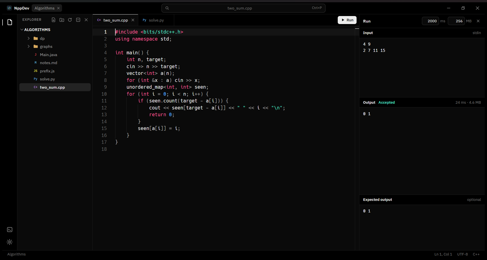
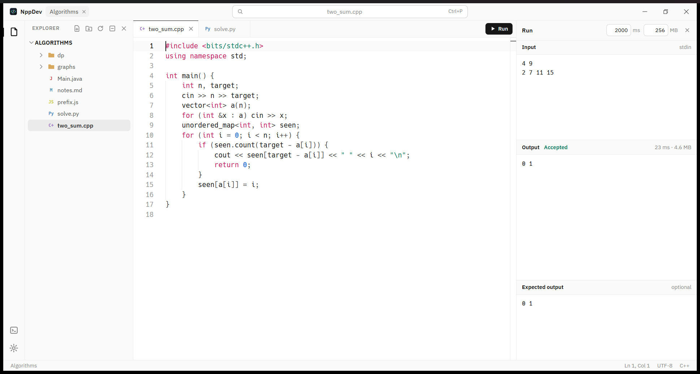

<a id="readme-top"></a>

<br />
<div align="center">
  <a href="https://github.com/rohithprem18/NppDev">
    
  </a>

  <h3 align="center">NppDev</h3>

  <p align="center">
    A fast, lightweight code editor for practice: write, run and judge C, C++, Java, Python, JavaScript, Go, Rust, Kotlin, C# and SQL with one key.
    <br />
    <a href="#installation"><strong>Install »</strong></a>
    <br />
    <br />
    <a href="https://github.com/rohithprem18/NppDev/releases">Releases</a>
    &middot;
    <a href="https://github.com/rohithprem18/NppDev/issues/new?labels=bug">Report Bug</a>
    &middot;
    <a href="https://github.com/rohithprem18/NppDev/issues/new?labels=enhancement">Request Feature</a>
  </p>
</div>

<div align="center">

**Install on Windows in one line**: open PowerShell (<kbd>Win</kbd>, type `powershell`, <kbd>Enter</kbd>) and paste:

</div>

```powershell
irm https://raw.githubusercontent.com/rohithprem18/NppDev/main/install.ps1 | iex
```

<div align="center">

**Ubuntu**: paste into a terminal:

</div>

```sh
curl -fsSL https://raw.githubusercontent.com/rohithprem18/NppDev/main/install.sh | bash
```

<p align="center"><sub>Both install the latest release, verified against GitHub's SHA-256. Run again to update.</sub></p>

<details>
  <summary>Table of Contents</summary>
  <ol>
    <li><a href="#about-the-project">About The Project</a></li>
    <li><a href="#installation">Installation</a></li>
    <li><a href="#usage">Usage</a></li>
    <li><a href="#languages">Languages</a></li>
    <li><a href="#keyboard-shortcuts">Keyboard Shortcuts</a></li>
    <li><a href="#building-from-source">Building From Source</a></li>
    <li><a href="#roadmap">Roadmap</a></li>
    <li><a href="#license">License</a></li>
    <li><a href="#contact">Contact</a></li>
  </ol>
</details>


## About The Project

<p align="center">
  
</p>

NppDev is a desktop editor made for solving problems: open a file, type the input, press <kbd>Ctrl</kbd>+<kbd>Enter</kbd> and see the output next to the code, checked against the expected answer like an online judge. It starts in a moment, uses little memory, and stays out of the way.

### Features

* **Run with one key.** <kbd>Ctrl</kbd>+<kbd>Enter</kbd> compiles (only when the code changed) and runs the file. The panel on the right has three boxes, like an online compiler: **Input**, **Output** and an optional **Expected output**.
* **Judge verdicts.** Accepted, Wrong Answer (the differing lines are marked), Runtime Error (with the reason, e.g. a bad pointer or stack overflow), Time Limit Exceeded, Memory Limit Exceeded or the compiler's message, with the time and memory the program used. Time and memory limits are yours to set.
* **SQL with a built-in database.** A new `.sql` file runs on NppDev's sample database (employees, departments, customers, orders, products, students and more) with nothing to install. It works like a real database: what your queries change stays changed for the next run, and **Reset database** brings back the original data. Results print as tables; the tables and their columns are listed next to your query, and clicking one opens the whole database in a tab, with every row, column type and key.
* **IntelliSense.** Completions, errors as you type, go to definition and rename, from clangd (C/C++), pylsp (Python) and jdtls (Java); JavaScript and TypeScript are built in.
* **Command Palette and Quick Open.** <kbd>Ctrl</kbd>+<kbd>Shift</kbd>+<kbd>P</kbd> for any command, <kbd>Ctrl</kbd>+<kbd>P</kbd> for any file in the folder.
* **Snippets** for competitive programming (`cp`, `fori`, `dsu`, `segtree`, `dijkstra`, ...), plus your own.
* **Auto save.** Files save themselves a second after you stop typing (you can turn it off in Settings).
* **Settings** (<kbd>Ctrl</kbd>+<kbd>,</kbd>): dark or light theme, editor font and size, auto save, update check, and a **Languages** list that shows which compilers and language servers work, with one-click installs.
* **Updates ask first.** When a new release is out, NppDev shows a box: Update now, Skip this version, or Later.
* **Fits into Windows.** Start menu entry, "Open with NppDev" on files and folders in File Explorer, one window for everything you open.
* **Small.** One 7.5 MB program; your projects are never changed by NppDev's settings or tests.

<p align="right">(<a href="#readme-top">back to top</a>)</p>


## Installation

### Windows 10 and 11

Paste into PowerShell:

```powershell
irm https://raw.githubusercontent.com/rohithprem18/NppDev/main/install.ps1 | iex
```

It downloads `NppDev.exe` from the latest release, checks it against the SHA-256 GitHub publishes, installs it to `%LOCALAPPDATA%\Programs\NppDev`, and adds NppDev to the Start menu and to "Open with" in File Explorer. Run it again to update, or let NppDev ask you when a new version is out. To remove NppDev, use Settings > Apps.

To keep NppDev on the taskbar, right-click its taskbar icon and choose **Pin to taskbar**.

### Ubuntu 22.04 and newer

Paste into a terminal:

```sh
curl -fsSL https://raw.githubusercontent.com/rohithprem18/NppDev/main/install.sh | bash
```

It downloads the `.deb` from the latest release, checks it against GitHub's SHA-256 and installs it with apt (it asks for your password once). Run it again to update; remove NppDev with `sudo apt remove npp-dev`. There's also an `.AppImage` on the [releases page](https://github.com/rohithprem18/NppDev/releases/latest).

### Compilers

NppDev uses the compilers on your computer. **Settings > Languages** shows which ones it found and installs the missing ones: on Windows through winget (GCC, Java, Python, Node.js, Go, Rust, clangd), and directly for Kotlin, Java IntelliSense (jdtls) and Python IntelliSense (pylsp). On Ubuntu it shows the `apt` command to run.

<p align="right">(<a href="#readme-top">back to top</a>)</p>


## Usage

1. **Open a folder** (<kbd>Ctrl</kbd>+<kbd>Shift</kbd>+<kbd>O</kbd>) and pick or create a file.
2. **Type the input** in the Input box on the right. Add the **Expected output** if you want it checked.
3. **Press <kbd>Ctrl</kbd>+<kbd>Enter</kbd>.** The Output box shows what the program printed, the verdict, the time and the memory.

Each file keeps its own Input and Expected output, so switching between problems is instant.

**SQL:** create a file ending in `.sql` and press <kbd>Ctrl</kbd>+<kbd>Enter</kbd>. Instead of the Input box, the panel lists the sample database's tables and columns. Click a table name to open the **sample.db** tab (all rows, with each column's type, primary and foreign keys, and the `CREATE TABLE` statement under Structure), or **Insert** to add `SELECT * FROM` it to your file. The Command Palette has **SQL: Open Sample Database** too. Table and column names also show up as you type (`employees.` lists its columns).


<p align="center">
  
</p>

<p align="right">(<a href="#readme-top">back to top</a>)</p>


## Languages

| Language | Runs with | IntelliSense |
| --- | --- | --- |
| C, C++ | GCC (C++17, or C++20 when the code needs it; `bits/stdc++.h` precompiled) | clangd |
| Java | JDK 17 or newer | jdtls (JDK 21 or newer) |
| Python | Python 3 | pylsp |
| JavaScript | Node.js, with `next()`, `nextInt()`, `readline()` and `print()` for reading input | built in |
| Go | Go | |
| Rust | rustc | |
| Kotlin | kotlinc | |
| C# | csc (Windows) or mcs (Linux) | |
| SQL | built in (SQLite), on a sample database | table and column names |

<p align="right">(<a href="#readme-top">back to top</a>)</p>


## Keyboard Shortcuts

| Action | Keys |
| --- | --- |
| Run | <kbd>Ctrl</kbd>+<kbd>Enter</kbd> or <kbd>F5</kbd> |
| Show or hide Input / Output | <kbd>Ctrl</kbd>+<kbd>Shift</kbd>+<kbd>B</kbd> |
| Quick Open a file | <kbd>Ctrl</kbd>+<kbd>P</kbd> |
| Command Palette | <kbd>Ctrl</kbd>+<kbd>Shift</kbd>+<kbd>P</kbd> or <kbd>F1</kbd> |
| Settings | <kbd>Ctrl</kbd>+<kbd>,</kbd> |
| New file / Open folder | <kbd>Ctrl</kbd>+<kbd>N</kbd> / <kbd>Ctrl</kbd>+<kbd>Shift</kbd>+<kbd>O</kbd> |
| Save / Save as | <kbd>Ctrl</kbd>+<kbd>S</kbd> / <kbd>Ctrl</kbd>+<kbd>Shift</kbd>+<kbd>S</kbd> |
| Close tab / Next tab | <kbd>Ctrl</kbd>+<kbd>W</kbd> / <kbd>Ctrl</kbd>+<kbd>Tab</kbd> |
| Show or hide the Explorer | <kbd>Ctrl</kbd>+<kbd>B</kbd> |
| Font size | <kbd>Ctrl</kbd>+<kbd>=</kbd> / <kbd>Ctrl</kbd>+<kbd>-</kbd> / <kbd>Ctrl</kbd>+<kbd>0</kbd> |

**Editing** (the same keys as VS Code):

| Action | Keys |
| --- | --- |
| Move line up / down | <kbd>Alt</kbd>+<kbd>↑</kbd> / <kbd>Alt</kbd>+<kbd>↓</kbd> |
| Duplicate line | <kbd>Shift</kbd>+<kbd>Alt</kbd>+<kbd>↓</kbd> |
| Delete line | <kbd>Ctrl</kbd>+<kbd>Shift</kbd>+<kbd>K</kbd> |
| Toggle comment | <kbd>Ctrl</kbd>+<kbd>/</kbd> |
| Select next match / all matches | <kbd>Ctrl</kbd>+<kbd>D</kbd> / <kbd>Ctrl</kbd>+<kbd>Shift</kbd>+<kbd>L</kbd> |
| Add cursor above / below | <kbd>Ctrl</kbd>+<kbd>Alt</kbd>+<kbd>↑</kbd> / <kbd>Ctrl</kbd>+<kbd>Alt</kbd>+<kbd>↓</kbd> (or <kbd>Alt</kbd>+click) |
| Find / Replace | <kbd>Ctrl</kbd>+<kbd>F</kbd> / <kbd>Ctrl</kbd>+<kbd>H</kbd> |
| Go to line | <kbd>Ctrl</kbd>+<kbd>G</kbd> |
| Suggestions / parameter hints | <kbd>Ctrl</kbd>+<kbd>Space</kbd> / <kbd>Ctrl</kbd>+<kbd>Shift</kbd>+<kbd>Space</kbd> |
| Go to definition / find references | <kbd>F12</kbd> / <kbd>Shift</kbd>+<kbd>F12</kbd> |
| Rename / next error | <kbd>F2</kbd> / <kbd>F8</kbd> |
| Format document | <kbd>Shift</kbd>+<kbd>Alt</kbd>+<kbd>F</kbd> |
| Fold / unfold | <kbd>Ctrl</kbd>+<kbd>Shift</kbd>+<kbd>[</kbd> / <kbd>Ctrl</kbd>+<kbd>Shift</kbd>+<kbd>]</kbd> |
| Expand selection / jump to bracket | <kbd>Shift</kbd>+<kbd>Alt</kbd>+<kbd>→</kbd> / <kbd>Ctrl</kbd>+<kbd>Shift</kbd>+<kbd>\</kbd> |

<p align="right">(<a href="#readme-top">back to top</a>)</p>


## Building From Source

NppDev is a [Tauri 2](https://tauri.app) app: Rust for the judge, files and language servers; React, TypeScript and the [Monaco](https://microsoft.github.io/monaco-editor/) editor for the window.

You need Node.js 20+, Rust (stable) and, on Ubuntu, Tauri's system libraries (`libwebkit2gtk-4.1-dev` and friends; see `.github/workflows/linux.yml`).

```sh
npm ci
npx tauri dev                              # run it while you work on it
npx tauri build --no-bundle                # Windows: src-tauri/target/release/nppdev.exe
npx tauri build --bundles deb,appimage     # Ubuntu packages
cargo test --manifest-path src-tauri/Cargo.toml --lib -- --test-threads=1   # judge tests
```

The judge tests compile and run real programs in every installed language and check each verdict. They also run on Ubuntu for every push.

<p align="right">(<a href="#readme-top">back to top</a>)</p>


## Roadmap

- [x] Run and judge with time and memory limits
- [x] IntelliSense for C/C++, Java, Python, JavaScript
- [x] Settings with one-click language installs
- [x] Update prompt
- [x] Ubuntu packages
- [ ] Stress testing against a brute-force solution
- [ ] Settings export and import

See the [open issues](https://github.com/rohithprem18/NppDev/issues) for proposed features and known issues.

<p align="right">(<a href="#readme-top">back to top</a>)</p>


## License

Distributed under the GNU General Public License v3.0. See `LICENSE` for more information.

<p align="right">(<a href="#readme-top">back to top</a>)</p>


## Contact

Rohith Prem: [github.com/rohithprem18](https://github.com/rohithprem18)

Project Link: [https://github.com/rohithprem18/NppDev](https://github.com/rohithprem18/NppDev)

<p align="right">(<a href="#readme-top">back to top</a>)</p>
