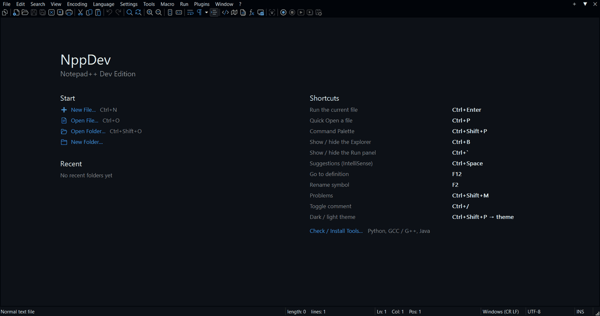

<a id="readme-top"></a>

<!-- PROJECT LOGO -->
<br />
<div align="center">
  <a href="https://github.com/rohithprem18/NppDev">
    
  </a>

  <h3 align="center">NppDev — Notepad++ Dev Edition</h3>

  <p align="center">
    A fast, VS Code-style editor for coding practice: write, run and judge C, C++, Java, Python and JavaScript with one key.
    <br />
    <a href="#getting-started"><strong>Get started »</strong></a>
    <br />
    <br />
    <a href="https://github.com/rohithprem18/NppDev/releases">Releases</a>
    &middot;
    <a href="https://github.com/rohithprem18/NppDev/issues/new?labels=bug">Report Bug</a>
    &middot;
    <a href="https://github.com/rohithprem18/NppDev/issues/new?labels=enhancement">Request Feature</a>
  </p>
</div>


<!-- QUICK INSTALL -->
<div align="center">

**Install in one line** — open PowerShell (<kbd>Win</kbd>, type `powershell`, <kbd>Enter</kbd>) and paste:

</div>

```powershell
irm https://raw.githubusercontent.com/rohithprem18/NppDev/main/install.ps1 | iex
```

<p align="center"><sub>Always installs the latest release, verified against GitHub's SHA-256. Run it again to update.</sub></p>


<!-- TABLE OF CONTENTS -->
<details>
  <summary>Table of Contents</summary>
  <ol>
    <li>
      <a href="#about-the-project">About The Project</a>
      <ul>
        <li><a href="#features">Features</a></li>
        <li><a href="#built-with">Built With</a></li>
      </ul>
    </li>
    <li>
      <a href="#getting-started">Getting Started</a>
      <ul>
        <li><a href="#prerequisites">Prerequisites</a></li>
        <li><a href="#installation">Installation</a></li>
      </ul>
    </li>
    <li><a href="#usage">Usage</a></li>
    <li><a href="#roadmap">Roadmap</a></li>
    <li><a href="#contributing">Contributing</a></li>
    <li><a href="#license">License</a></li>
    <li><a href="#contact">Contact</a></li>
    <li><a href="#acknowledgments">Acknowledgments</a></li>
  </ol>
</details>


<!-- ABOUT THE PROJECT -->
## About The Project

<p align="center">
  
</p>

Notepad++ starts in a blink and stays out of your way, but practising problems in it means a terminal on the
side, no autocomplete and no way to check your answer. VS Code has all of that, but it's heavy for a quick
solution. **NppDev** is Notepad++ with the parts of VS Code that matter for coding practice built in.

Here's why you might like it:
* **One key runs your code** — <kbd>Ctrl</kbd>+<kbd>Enter</kbd> compiles and runs, with Input and Expected
  output boxes and online-judge verdicts.
* **IntelliSense in every language** — autocomplete, errors as you type, go to definition, rename.
* **It sets itself up** — missing compilers are installed for you with one click; whatever you already have is used.

### Features

| | |
|---|---|
| **Run & judge** | Run the current `.c` `.cpp` `.java` `.py` `.js` file; verdicts **Accepted**, **Wrong answer** (line-by-line diff), **Runtime error** (explained), **Time limit exceeded**, **Compilation error** (click to jump to the line) |
| **Fast** | Unchanged code isn't rebuilt; `<bits/stdc++.h>` is precompiled in the background; C++ builds as C++17 and switches to C++20 when your code needs it |
| **IntelliSense** | clangd (C/C++), Eclipse JDT (Java), pylsp (Python), TypeScript (JavaScript) with VS Code keys |
| **Snippets** | Type `sout`, `fori`, `cout`, `tc`, `log`… and press <kbd>Tab</kbd> |
| **Explorer** | VS Code-style Explorer with New File / New Folder, file icons, one-click open; every folder remembers its open files |
| **Welcome page** | New File, Open File, Open Folder and recent folders when nothing is open |
| **Pickers** | Quick Open <kbd>Ctrl</kbd>+<kbd>P</kbd> and Command Palette <kbd>Ctrl</kbd>+<kbd>Shift</kbd>+<kbd>P</kbd> |
| **Themes** | GitHub Dark and light themes, Hack font, VS Code key bindings |
| **Tools installer** | Installs Python, GCC + clangd, a JDK, pylsp, Node.js and TypeScript with a progress bar |

<p align="right">(<a href="#readme-top">back to top</a>)</p>


### Built With

* [![Notepad++][Npp-badge]][Npp-url]
* [![C][C-badge]][C-url]
* [![Python][Python-badge]][Python-url]
* [![PowerShell][PowerShell-badge]][PowerShell-url]

<p align="right">(<a href="#readme-top">back to top</a>)</p>


<!-- GETTING STARTED -->
## Getting Started

NppDev installs for your user only (no administrator rights) and sets up everything else itself.

### Prerequisites

* **Windows 10 or 11** (64-bit)
* That's all. Python, GCC/G++, a Java JDK and Node.js are installed for you on first start if they are missing;
  versions you already have are used.

### Installation

1. Open **PowerShell**: press <kbd>Win</kbd>, type `powershell`, press <kbd>Enter</kbd>.
2. Paste this line and press <kbd>Enter</kbd>:
   ```powershell
   irm https://raw.githubusercontent.com/rohithprem18/NppDev/main/install.ps1 | iex
   ```
   It downloads the **latest release** from this repository, checks it against the **SHA-256 that GitHub
   publishes** for it, and starts the setup. Installed this way, Windows SmartScreen doesn't show a warning.
3. Click **Install**. NppDev starts when it's done.

**Update:** run the same line again — it updates NppDev in place and keeps your settings.
**Uninstall:** *Settings → Apps → NppDev → Uninstall*.

> On PCs with **Smart App Control** turned on, Windows blocks unsigned programs, including NppDev.

<p align="right">(<a href="#readme-top">back to top</a>)</p>


<!-- USAGE EXAMPLES -->
## Usage

**Run a program.** Open a file, type the program's input in the **Input** box, optionally the answer in
**Expected output**, and press <kbd>Ctrl</kbd>+<kbd>Enter</kbd>. Input and expected output are saved per file.

**JavaScript** files start empty — `input`, `next()`, `nextInt()`, `nextInts()` and `nextWords()` are ready to use:
```js
const n = nextInt();
const a = nextInts();
console.log(a.slice(0, n).reduce((s, x) => s + x, 0));
```

**Snippets** — type the word, press <kbd>Tab</kbd>:

| Language | Snippets |
|---|---|
| Java | `sout` `souf` `psvm` `fori` `fore` `sc` `br` `tc` `try` |
| C++ | `cout` `cin` `fori` `fore` `tc` `fastio` `vi` `vll` `pii` `struct` |
| C | `printf` `scanf` `main` `fori` `tc` |
| Python | `pr` `fori` `fore` `ints` `mapint` `tc` `def` `ifmain` |
| JavaScript | `log` `fori` `fore` `fn` `af` `try` |

**Keyboard shortcuts**

| Action | Keys | Action | Keys |
|---|---|---|---|
| Run | <kbd>Ctrl</kbd>+<kbd>Enter</kbd> | Suggestions | <kbd>Ctrl</kbd>+<kbd>Space</kbd> |
| Quick Open | <kbd>Ctrl</kbd>+<kbd>P</kbd> | Go to definition | <kbd>F12</kbd> |
| Command Palette | <kbd>Ctrl</kbd>+<kbd>Shift</kbd>+<kbd>P</kbd> | Find references | <kbd>Shift</kbd>+<kbd>F12</kbd> |
| Show / hide Explorer | <kbd>Ctrl</kbd>+<kbd>B</kbd> | Rename symbol | <kbd>F2</kbd> |
| Show / hide Run panel | <kbd>Ctrl</kbd>+<kbd>`</kbd> | Quick fix | <kbd>Ctrl</kbd>+<kbd>.</kbd> |
| Open Folder | <kbd>Ctrl</kbd>+<kbd>Shift</kbd>+<kbd>O</kbd> | Format document | <kbd>Shift</kbd>+<kbd>Alt</kbd>+<kbd>F</kbd> |
| Recent folders | <kbd>Ctrl</kbd>+<kbd>Shift</kbd>+<kbd>R</kbd> | Problems | <kbd>Ctrl</kbd>+<kbd>Shift</kbd>+<kbd>M</kbd> |
| Toggle comment | <kbd>Ctrl</kbd>+<kbd>/</kbd> | Next / previous problem | <kbd>F8</kbd> / <kbd>Shift</kbd>+<kbd>F8</kbd> |
| Select next match | <kbd>Ctrl</kbd>+<kbd>D</kbd> | Move line | <kbd>Alt</kbd>+<kbd>↑</kbd> / <kbd>↓</kbd> |

**Themes:** type `theme` in the Command Palette and pick **Color Theme: Dark** or **Light**.

**Tools:** *Plugins → Dev Tools → Check / Install Tools* shows every compiler and language server, installs
missing ones, and lets you pick a version when several are installed.

<p align="right">(<a href="#readme-top">back to top</a>)</p>


<!-- ROADMAP -->
## Roadmap

**Done**
- [x] Run panel with Input, Expected output and judge verdicts
- [x] IntelliSense for C, C++, Java, Python and JavaScript
- [x] VS Code-style Explorer, Welcome page, Quick Open and Command Palette
- [x] Snippets and VS Code key bindings
- [x] Automatic install of compilers and language servers
- [x] One-line install without SmartScreen warnings

**Next**
- [ ] Multiple test cases per file: several Input / Expected pairs, run all with one key
- [ ] Import sample tests from Codeforces, AtCoder and LeetCode problem pages
- [ ] Time and memory limits per file, with memory usage in the verdict
- [ ] Update check inside NppDev: get notified when a new release is out
- [ ] Your own snippets, editable from the Command Palette
- [ ] winget package and a code-signed setup

**Later**
- [ ] Stress testing: compare a solution with a brute-force one on random inputs
- [ ] Debugging with breakpoints (GDB for C/C++, Java, Python)
- [ ] Integrated terminal panel
- [ ] Git panel: changes, diff and commit
- [ ] More languages: Go, Rust, Kotlin and C#
- [ ] Export and import of all settings

See the [open issues](https://github.com/rohithprem18/NppDev/issues) for proposed features and known issues.

<p align="right">(<a href="#readme-top">back to top</a>)</p>


<!-- CONTRIBUTING -->
## Contributing

Contributions are welcome. If you have an idea that would make NppDev better, fork the repo and open a pull
request, or open an issue with the label "enhancement".

1. Fork the project
2. Create your feature branch (`git checkout -b feature/AmazingFeature`)
3. Commit your changes (`git commit -m 'Add some AmazingFeature'`)
4. Push to the branch (`git push origin feature/AmazingFeature`)
5. Open a pull request

### Building from source

Needs Windows 10/11, Notepad++ 8.9, MSYS2 with GCC (ucrt64) and PowerShell.

```powershell
powershell -ExecutionPolicy Bypass -File build.ps1        # -> build\NppDev-Setup.exe
```

`downloads\` must hold `NppLspClient_x64_0.0.40.zip`
([NppLspClient releases](https://github.com/Ekopalypse/NppLspClient/releases)); the Java language server is
fetched there by the build when missing, together with the official portable Notepad++ and NppLspClient.
`release.ps1 -Version 1.6 -Notes "..."` builds and publishes a release; `release.ps1 -Refresh` rebuilds the current one.

| Folder | Contents |
|---|---|
| `plugin/` | The Dev Tools plugin (C): Run panel, Explorer, Welcome page, pickers, snippets, key bindings |
| `devtools/` | `runner.py` (compile, run, judge), `tools.py` (finds compilers), `lsp-proxy.py`, Check / Install Tools |
| `installer/` | The setup program and its resources |
| `settings/` | Notepad++ settings: keys, theme, IntelliSense template |
| `install.ps1` | The one-line installer |

<p align="right">(<a href="#readme-top">back to top</a>)</p>


<!-- LICENSE -->
## License

Distributed under the GPL-3.0 License. See [`LICENSE`](LICENSE) for more information.

NppDev bundles, unchanged: [Notepad++](https://github.com/notepad-plus-plus/notepad-plus-plus) (GPL-3.0),
[NppLspClient](https://github.com/Ekopalypse/NppLspClient) (GPL-3.0),
[Eclipse JDT Language Server](https://github.com/eclipse-jdtls/eclipse.jdt.ls) (EPL-2.0) and the
[Hack font](https://github.com/source-foundry/Hack/blob/master/LICENSE.md) (MIT / Bitstream Vera).
NppDev is not affiliated with the Notepad++ project.

**Privacy:** NppDev collects and sends nothing. It goes online only when you ask it to install tools.

<p align="right">(<a href="#readme-top">back to top</a>)</p>


<!-- CONTACT -->
## Contact

Rohith Prem — [@rohithprem18](https://github.com/rohithprem18)

Project Link: [https://github.com/rohithprem18/NppDev](https://github.com/rohithprem18/NppDev)

<p align="right">(<a href="#readme-top">back to top</a>)</p>


<!-- ACKNOWLEDGMENTS -->
## Acknowledgments

* [Notepad++](https://notepad-plus-plus.org) by Don Ho — the editor at the heart of NppDev
* [NppLspClient](https://github.com/Ekopalypse/NppLspClient) — language server support for Notepad++
* [clangd](https://clangd.llvm.org), [Eclipse JDT LS](https://github.com/eclipse-jdtls/eclipse.jdt.ls),
  [python-lsp-server](https://github.com/python-lsp/python-lsp-server) and [TypeScript](https://www.typescriptlang.org)
* [WinLibs](https://winlibs.com), [Eclipse Temurin](https://adoptium.net), [Python](https://www.python.org) and [Node.js](https://nodejs.org)
* [Hack font](https://sourcefoundry.org/hack/)

<p align="right">(<a href="#readme-top">back to top</a>)</p>


<!-- MARKDOWN LINKS & IMAGES -->
[Npp-badge]: https://img.shields.io/badge/Notepad++-90E59A?style=for-the-badge&logo=notepadplusplus&logoColor=black
[Npp-url]: https://notepad-plus-plus.org
[C-badge]: https://img.shields.io/badge/C-A8B9CC?style=for-the-badge&logo=c&logoColor=black
[C-url]: https://en.wikipedia.org/wiki/C_(programming_language)
[Python-badge]: https://img.shields.io/badge/Python-3776AB?style=for-the-badge&logo=python&logoColor=white
[Python-url]: https://www.python.org
[PowerShell-badge]: https://img.shields.io/badge/PowerShell-5391FE?style=for-the-badge&logo=powershell&logoColor=white
[PowerShell-url]: https://learn.microsoft.com/powershell/
